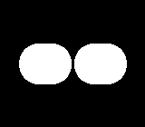
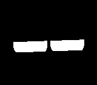
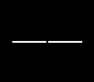
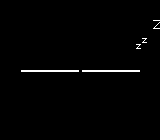
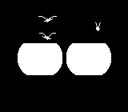
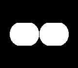

# RoboEyes

Reusable ESP-IDF eyes animation framework.

## Emotion Gallery

| Neutral | Happiness | Curiosity |
| --- | --- | --- |
|  |  |  |

| Exhaustion | Falling Asleep | Waking Up |
| --- | --- | --- |
|  |  |  |

| Snoring | Dizzy | Playful Pong |
| --- | --- | --- |
|  |  |  |

## Components

- `eyes`: platform-light core animation, renderer, sequencer, GIF helpers.
- `eyes_emotion_cycle`: ready-made emotion cycle runner for firmware demos.
- `eyes_log_sink`: log-based frame sink for headless firmware smoke tests.
- `eyes_lcd_sink`: frame sink that sends rendered grayscale frames to LCD.
- `lcd_st7789`: ST7789 SPI display wrapper and board config presets.
- `pixel_convert`: grayscale-to-RGB565 conversion helper.

## Use In ESP-IDF Project

Copy or submodule this `RoboEyes` directory, then include its helper before
`project()` in your root `CMakeLists.txt`:

```cmake
include("${CMAKE_CURRENT_LIST_DIR}/frameworks/RoboEyes/roboeyes.cmake")
```

The helper includes all RoboEyes components by default. Apps can include only
selected components by setting `ROBOEYES_COMPONENTS` before the helper:

```cmake
set(ROBOEYES_COMPONENTS eyes eyes_emotion_cycle eyes_log_sink)
include("${CMAKE_CURRENT_LIST_DIR}/frameworks/RoboEyes/roboeyes.cmake")
```

Apps can also use presets:

```cmake
set(ROBOEYES_PRESET headless) # core, headless, or st7789
include("${CMAKE_CURRENT_LIST_DIR}/frameworks/RoboEyes/roboeyes.cmake")
```

Apps that need ST7789 output need `eyes`, `eyes_lcd_sink`, `lcd_st7789`, and
`pixel_convert`.

## Firmware Wiring

Create display, sink, animator, renderer, and player:

```cpp
lcd::St7789Display display;
ESP_ERROR_CHECK(display.init(lcd_cfg));

eyes::EyesAnimator animator;
eyes::EyesRenderer renderer;

eyes_lcd::EyesLcdSinkConfig sink_cfg = {
    .display = &display,
};
eyes_lcd::EyesLcdSink sink(sink_cfg);

eyes::EyesClipPlayer player(animator, renderer, sink);
eyes::ClipOptions opt;
opt.size = {lcd_cfg.width, lcd_cfg.height};
opt.fps = 30;
opt.realtime = true;
```

Play one emotion:

```cpp
player.play(eyes::Emotion::Happiness, opt);
```

Run built-in demo cycle:

```cpp
eyes_cycle::run_forever(player, opt);
```

## Host GIF Tool

Build preview GIFs without ESP-IDF:

```bash
cmake -S tools/eyes_gif_runner -B build-host-roboeyes_gif_runner
cmake --build build-host-roboeyes_gif_runner --parallel 4
build-host-roboeyes_gif_runner/eyes_gif_runner --out out/eyes_gifs --emotion all
```

## Examples

- `examples/espidf_headless`: ESP-IDF smoke test with log output and no display wiring.
- `examples/espidf_st7789_supermini_c3`: ESP32-C3 Super Mini ST7789 demo with
  safe GPIO wiring.
- `examples/espidf_st7789_tinys3`: TinyS3 ST7789V3 240x280 demo with 90 degree
  rotation.

## Tests

- Component tests live beside framework components.
- Host GIF behavior can be checked with the host GIF tool.
- Downstream ESP-IDF apps should run their own component test and build suites.

## License

MIT. See `LICENSE`.
